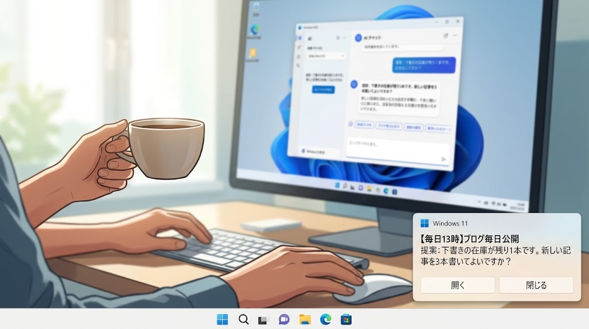

# routine-notify



A Windows add-on for Claude Code (desktop app) routines (scheduled tasks). It tells you when a routine needs you, and lets you jump straight to that session.

- **Toast notification** when a routine is waiting for your GO, needs a decision, or failed. It stays until you click it; "開く" (Open) jumps to the session via a `claude://` link.
- **Tray list (optional)**: a small icon next to the clock. Blue = normal, orange + count = waiting for you, red = failed. Click it to see every routine with its state (waiting / failed / running / next scheduled time); click a row to open that session. Useful while the desktop app's "Routines" sidebar section is hidden ([anthropics/claude-code#102520](https://github.com/anthropics/claude-code/issues/102520)).
- Optionally mirrors the notification to Slack.

The on-screen labels are in Japanese (e.g. GO待ち = waiting for you, 失敗 = failed, 実行中 = running, 次 = next run).

## Install

```
git clone https://github.com/tnajun/routine-notify "$env:USERPROFILE\.claude\skills\routine-notify"
```

To also post to Slack, create `~/.claude/slack-notify.json` (bot with `chat:write`):

```json
{"botToken": "xoxb-...", "channel": "C0123456789"}
```

## Try the notification

```
powershell -NoProfile -ExecutionPolicy Bypass -File notify.ps1 -Title "Test" -Message "This is a test" -Link "claude://claude.ai/epitaxy/<session id>"
```

Add `-Kind fail` for a failure (red in the tray list). Routines call it through `SKILL.md`.

## Tray list (optional)

### 1. Add the status hook

Copy `hooks/routine_status.py` to `~/.claude/hooks/` and add it to `hooks` in `~/.claude/settings.json` (needs Python 3):

```json
{
  "hooks": {
    "UserPromptSubmit": [{"matcher": "", "hooks": [{"type": "command", "command": "python \"%USERPROFILE%/.claude/hooks/routine_status.py\"", "timeout": 10}]}],
    "Stop": [{"matcher": "", "hooks": [{"type": "command", "command": "python \"%USERPROFILE%/.claude/hooks/routine_status.py\"", "timeout": 10}]}],
    "PermissionRequest": [{"matcher": "", "hooks": [{"type": "command", "command": "python \"%USERPROFILE%/.claude/hooks/routine_status.py\"", "timeout": 10}]}]
  }
}
```

If you already have hooks for these events, add one entry to their `hooks` array. Use a full path if `%USERPROFILE%` is not expanded.

### 2. Start the tray list

```
powershell -STA -NoProfile -WindowStyle Hidden -ExecutionPolicy Bypass -File "$env:USERPROFILE\.claude\skills\routine-notify\tray.ps1"
```

To start it at sign-in, put a shortcut with this command in the Startup folder (`shell:startup`). If the icon lands in the hidden-icons area (`^`), drag it next to the clock.

### Pinning

Keep the routines you check often at the top of the list:

1. In the Claude app, open the routine's detail page and edit its name with the pencil icon
2. Put 📌 anywhere in the name and save (e.g. `[daily 9:40] 📌 Draft mail replies`)

The routine then always sits at the top, whatever its state or schedule, with a red pin next to its name. Remove 📌 to unpin. The list re-sorts itself every 20 seconds, so no restart is needed.

### How it works

- Routine names and schedules: the desktop app's own `scheduled-tasks.json`
- Running: the routine's conversation log was written in the last 10 minutes
- Waiting / failed: `notify.ps1` writes `~/.claude/routine-status.json`
- Done / permission wait: the hook (`routine_status.py`) writes the same file

Tested on Windows 10/11 with Windows PowerShell 5.1.

## License

MIT
